<picture>
  <source media="(max-width: 600px) and (prefers-reduced-motion: reduce)" srcset="assets/hero-light-compact-static.svg">
  <source media="(max-width: 600px)" srcset="assets/hero-light-compact.svg">
  <source media="(prefers-reduced-motion: reduce)" srcset="assets/hero-light-static.svg">
  
</picture>

Most of what I build is private: web apps in TypeScript and React, and a React Native app. What is public here is the smaller work around it, and my web security practice, where authentication and access control get most of my time.

**Now, November 2026:** building a React Native app with its own motion system, and publishing my Obsidian setups in [obsidian-bank](https://github.com/kocayinsec/obsidian-bank).

## Public projects

**[CurvedFor Claude Plugin](https://github.com/kocayinsec/curvedfor-claude-plugin)**  
A Claude plugin for preparing launch-page briefs and checking their structure over MCP. The connector is read-only.

**[obsidian-bank](https://github.com/kocayinsec/obsidian-bank)**  
Ready-to-use Obsidian setups with default content only. The first one is a daily habit dashboard.

**[Network Automation Sender](https://github.com/kocayinsec/network_automation_sender)**  
A study project in Python: an asyncio HTTP request runner with a priority queue and retries.

**[Aspergillus Pro](https://github.com/kocayinsec/aspergillus-pro.io)**  
A prototype of a network-traffic dashboard. It plays simulated traffic; nothing is captured yet.

## Security practice

I'm focusing on authentication, access control, SSRF and API security.

- **PortSwigger Web Security Academy:** 40+ labs completed.
- **Hack The Box:** ongoing practice.

What I use

Python, TypeScript, React, React Native and Expo.  
Burp Suite, Nmap, Nuclei and ffuf for security practice; MCP and n8n for automation.

---

[curvedfor.com](https://curvedfor.com)
