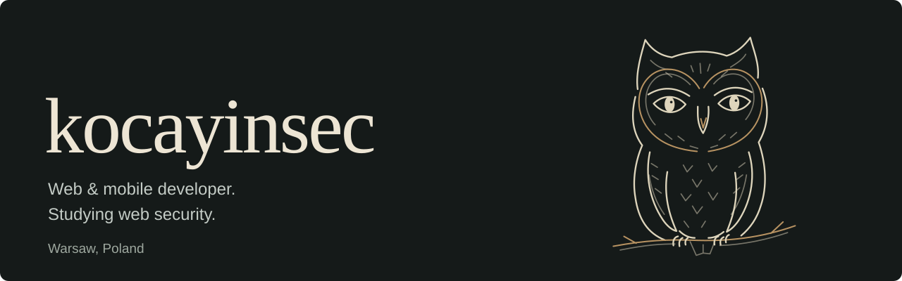

<picture>
  <source media="(max-width: 600px) and (prefers-reduced-motion: reduce)" srcset="assets/hero-compact-static.svg">
  <source media="(max-width: 600px)" srcset="assets/hero-compact.svg">
  <source media="(prefers-reduced-motion: reduce)" srcset="assets/hero-static.svg">
  
</picture>

I build web and mobile apps, and write tools for the repetitive work around them. I'm also working through web security labs, with a particular interest in authentication and access control.

## A few projects

**[CurvedFor Claude Plugin](https://github.com/kocayinsec/curvedfor-claude-plugin)**  
A Claude plugin for preparing launch-page briefs and checking their structure over MCP. The connector is read-only.

**[Network Automation Sender](https://github.com/kocayinsec/network_automation_sender)**  
A Python tool for HTTP request workflows, with async execution, queues and retries.

**[Aspergillus Pro](https://github.com/kocayinsec/aspergillus-pro.io)**  
A prototype for viewing network traffic in a dashboard.

## Security practice

I'm focusing on authentication, access control, SSRF and API security.

- **PortSwigger Web Security Academy:** 40+ labs completed.
- **Hack The Box:** ongoing practice.

What I use

Python, TypeScript, React, React Native and Expo.  
Burp Suite, Nmap, Nuclei and ffuf for security practice; MCP and n8n for automation.

---

[curvedfor.com](https://curvedfor.com)
